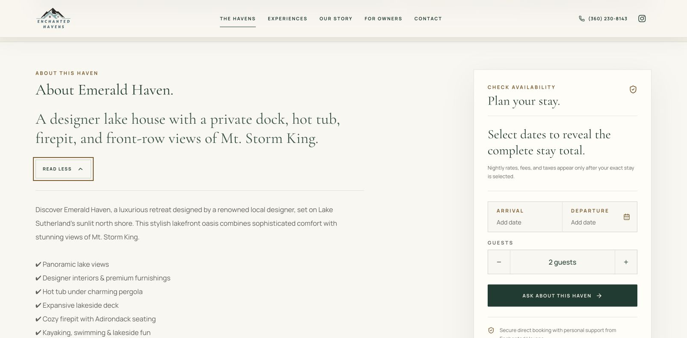
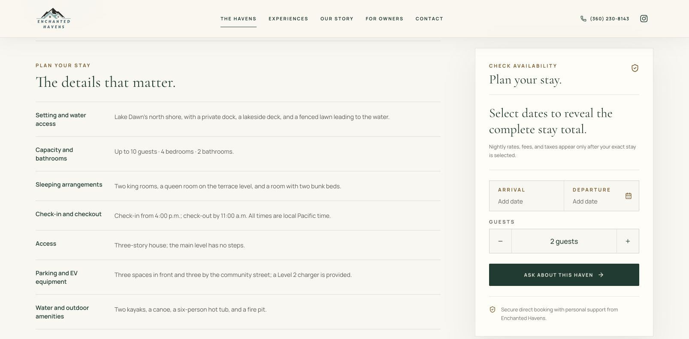

# Ticket 840 — complete readable property content

Implemented October 27, 2026 for [Cotton Candy #840](https://yourcottoncandy.com/tickets/840/page), workstream 2. [PR #9](https://github.com/richardchen723/enchanted-havens/pull/9) contains this release. The preview is available at [Emerald Haven](https://enchanted-havens-git-codex-ti-9db142-richardchen-6494s-projects.vercel.app/havens/emerald-haven#about). This record describes preview validation, not a production deployment.

## What changed

Previously, Read More inserted the long description only after a JavaScript click handler ran. Its text could exist in serialized application data while remaining absent from ordinary readable HTML. The component now renders the entire description on the server inside a native `details`/`summary` disclosure. The browser supplies expansion, collapse, keyboard interaction, and accessibility state. The control has a visible keyboard focus outline and a 44-pixel minimum height.

All six homes also have a Check-in and checkout row in Plan Your Stay. It shares the same arrival formatter and values as checkout, and states that times are local Pacific time. The workstream 1 fact rows already supply the sleeping arrangements, access, parking, supplied amenities, pet fee, and visitor approval information required by workstream 2.

## Arrival evidence and decision

Richard directed: “check with airbnb. airbnb time is the right one.” The Things to know sections on all six Airbnb listings were checked in the browser on October 27, 2026.

| Home and source | Airbnb check-in | Airbnb checkout |
| --- | --- | --- |
| [Blue Haven](https://www.airbnb.com/rooms/634384398560090584) | 3–11 p.m. | Before 10 a.m. |
| [Sea-Renity Haven](https://www.airbnb.com/rooms/862304966484869756) | 4–11 p.m. | Before 11 a.m. |
| [Emerald Haven](https://www.airbnb.com/rooms/922135705438701292) | 4–11 p.m. | Before 11 a.m. |
| [Fair Haven](https://www.airbnb.com/rooms/923125727364307502) | 3–11 p.m. | Before 10 a.m. |
| [Aurora Haven](https://www.airbnb.com/rooms/942394610289436238) | 3–11 p.m. | Before 10 a.m. |
| [Reflection Haven](https://www.airbnb.com/rooms/1294876804636674762) | After 4 p.m. | Before 11 a.m. |

Reflection's Airbnb listing does not set a check-in closing time. Its website arrival summary now says “Check-in from 4:00 p.m.; check-out by 11:00 a.m.” instead of imposing an 11 p.m. closing time. The other five schedules match the pre-existing website values. Airbnb source sections and verification date are recorded with the shared property facts.

## Validation

- 244 unit tests passed; six existing tests skipped. New coverage verifies complete description/disclosure text in server markup, safe text escaping, empty/duplicate descriptions, and all six arrival schedules.
- Production build, including TypeScript checking, passed. ESLint has no errors and two existing unused-variable warnings in `lib/owner-inquiries.ts`.
- Vercel preview for application commit `a45edf026a15f6c8c02c4f9e6c12dd4bf522a570` is Ready and its deployment status passed.
- Authenticated HTTP GET checks of all six preview property pages executed no JavaScript. Parsing ordinary HTML with scripts excluded found every complete description, arrival row, Pacific timezone, USD 100 pet fee, and written-approval visitor rule. Every full description matches the current production description exactly after boundary whitespace trimming. See [machine-readable evidence](html-validation.json).
- The existing processing-fee disclosure is preserved on the five homes whose production descriptions contain it. Sea-Renity's existing description does not contain that sentence; it was preserved without adding or changing fee policy. Reconciliation of processing fees remains deferred at Richard's request.
- Chrome desktop review and a 390 × 844 mobile viewport verified readable wrapping, native keyboard expansion/collapse, a visible focus outline, and access to the booking controls. Mobile document width was 390 pixels, with no horizontal overflow; the bottom Choose dates shortcut remained available. The temporary viewport override was reset afterward.
- Keyboard checks covered Read More/Read Less, the full amenity list, a FAQ, the mobile Choose dates shortcut, month navigation, arrival/departure selection, and increasing guest count. The calendar explained its two-night minimum and disabled unavailable dates.
- Emerald, November 15–17, 2026, two guests returned an itemized USD 1,284.43 quote in an `aria-live="polite"` region. Changing to three guests updated the readable count, triggered quote recalculation, and updated the inquiry handoff. This is a historical QA observation, not a current offer.
- Emerald, November 2–4, 2026 returned “This haven is not available for the selected dates” in a `role="alert"` element. No reservation, inquiry, or payment was submitted.

### Readable About-section text before interaction

These counts exclude scripts and include the section heading, summary, and disclosure labels. The improvement is readable HTML coverage, not a change in property-description wording.

| Home | Production before | Preview after | Complete description preserved |
| --- | ---: | ---: | --- |
| Blue | 152 characters | 7,518 characters | Yes |
| Sea-Renity | 139 | 7,705 | Yes |
| Emerald | 144 | 8,250 | Yes |
| Fair | 144 | 8,674 | Yes |
| Aurora | 147 | 6,995 | Yes |
| Reflection | 143 | 6,576 | Yes |

## Screenshots

Desktop: the expanded description remains alongside the booking controls.

Mobile: the full description wraps within the viewport, with the booking shortcut still accessible.

Reflection: the consistent arrival row reflects Airbnb's current schedule.

## Scope and release

Payment-processing disclosures and cancellation/payment calculations are unchanged. Owner-confirmed workstream 1 facts, USD, and Reflection Point retirement protections remain in place. Public amenity copy continues to describe supplied amenities. Workstreams 3–8 remain pending, so ticket 840 stays assigned to Richard Chen and In Progress.

The PR is prepared for review. No production merge or deployment is part of this validation record. After release, repeat the six ordinary-HTML checks against production and confirm the native disclosure and arrival row. A rollback is a revert of this PR; it requires no database migration or content-service changes.
