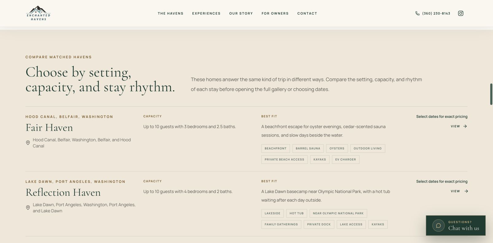
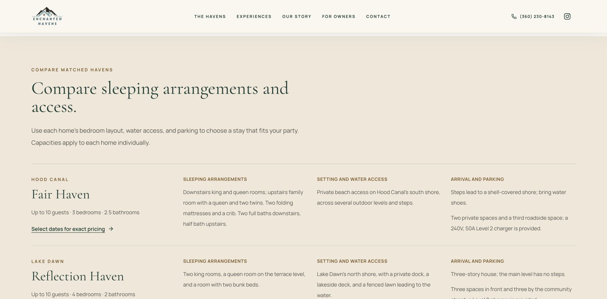

# Ticket #840: property identity and practical guides

Workstreams 3 and 4 for [Cotton Candy #840](https://yourcottoncandy.com/tickets/840/page), implemented October 27, 2026. [PR #10](https://github.com/richardchen723/enchanted-havens/pull/10) is ready for review. [Open the hosted retreat-guide preview](https://enchanted-havens-1gyh0f5l7-richardchen-6494s-projects.vercel.app/groups/company-retreat-rental-pnw#compare-havens). Production release is separate.

## Owner decisions applied

- Publish precise coordinates in structured data; keep street addresses private. The six coordinate pairs were read from each home's live Hostaway-backed `/booking/{slug}` page on October 27, 2026. They are recorded in `lib/property-locations.ts`; street addresses and postal codes are omitted from rental schema.
- Leave measured dining-seat counts, desk/workspace specifications, and Wi-Fi speeds out. Retreat guides invite guests to confirm their requirements with the stay team.
- Preserve the confirmed Lake Dawn location, sleeping arrangements, docks, hot tubs/sauna, kayaks, access, parking, USD 100 flat pet fee and advance-notice rule, and written approval for extra visitors/event-style use from workstreams 1 and 2.
- Public amenity content describes supplied amenities. Payment-processing fees and booking/cancellation calculations are unchanged. Workstreams 5–8 remain separate.

## Workstream 3: one property identity across the site

The old property schema used `LodgingBusiness`, gave homes the brand's social identities, truncated amenities, repeated photographs, encoded occupancy as a maximum range, and declared limited availability without selected dates. Some page families also calculated a rating from selected positive testimonials.

The shared `buildVacationRentalEntity` now supplies the same record to property pages, the homepage, collection, guides, and hubs:

- `VacationRental` with an `Accommodation`, stable listing-based `identifier`, canonical property `@id`, and that home's Airbnb URL in `sameAs`. Brand social links remain on brand entities.
- Owner-confirmed occupancy in `QuantitativeValue.value`, bedrooms, sleeping-layout text, bathroom information, pet/visitor policies, and the complete normalized amenity list.
- Precise `GeoCoordinates`, locality/state/country, and local check-in/out times without a fixed daylight-saving offset. The visible map remains labeled approximate and says the **street address** is shared with confirmed guests.
- Eight visually reviewed photographs per home, including bedroom, bathroom, and common area. The 48 selections and captions are recorded in `lib/property-photos.ts`; they also belong to the visible full galleries and editorial fallback. Transformations of one Hostaway asset are deduplicated.
- Accurate captions for reviewed images; neutral property/location labels for other images instead of inferring a photo's subject from an amenity tag.
- Date-selection booking actions and brand-level offer catalogs, without static availability, prices, or ratings. Existing visible, dated Airbnb review summaries are unchanged; the broader review-proof workstream is separate.

Bathroom totals require care: Schema.org defines `numberOfBathroomsTotal` as an integer room count, not the public “2.5 baths” convention. For the two 2.5-bath homes, that optional field is omitted and the confirmed 2.5 count and available layout details remain in `additionalProperty` and visible copy. No full/half-room split is invented.

## Workstream 4: useful comparisons on the existing 36 guides

All 36 URLs are retained. No new landing pages or redirects are introduced.

- Replace repeated marketing tags and aggregate bedroom/bathroom counts with per-home sleeping arrangements, capacity, water access, entrance steps, and parking. Each capacity explicitly applies to one home.
- Add distinct planning notes for each guide: lake choices, beach/bluff access, included watercraft, hot-tub/sauna matches, family room assignments, team work requirements, wedding visitor plans, pets, and arrival routes.
- Distinguish Lake Sutherland, Lake Dawn, and Lake Crescent; identify the saltwater homes specifically as Whidbey Island and Hood Canal. Remove Reflection Haven from the collection's Lake Sutherland shortlist.
- Label NPS drive times as estimates **from Port Angeles**, with allowances for the home's starting point, traffic, entrance queues, and stops. Point guests to current park conditions instead of promising year-round road access.
- Explain Whidbey's bridge and ferry options, with official schedules/alerts. Include a sourced pet-friendly park planning note.
- Remove public “landing page,” “search intent,” “work-ready,” and “permit-safe” wording. Link guests to the relevant homes, exact-date pricing, related guides, and the stay team.

## Sources and limits

Property facts: the owner-confirmed, Airbnb-verified records already documented in `lib/property-facts.ts`. Photos: each home's public Hostaway gallery, visually reviewed October 27, 2026. Coordinates: each live first-party booking page on that date.

External planning references are linked beside the relevant public copy:

- [NPS Olympic trip planning](https://www.nps.gov/olym/planyourvisit/tripideas.htm) and [current conditions](https://www.nps.gov/olym/planyourvisit/conditions.htm).
- [NPS Whidbey road/ferry directions](https://www.nps.gov/ebla/planyourvisit/directions.htm) and [WSDOT ferry schedules](https://wsdot.wa.gov/travel/washington-state-ferries/schedules).
- [NPS Olympic pet guidance](https://www.nps.gov/olym/planyourvisit/pets.htm).

Schema reference: [Schema.org Accommodation](https://schema.org/Accommodation) and [Google vacation-rental structured data](https://developers.google.com/search/docs/appearance/structured-data/vacation-rental).

Google's vacation-rental feature has separate integration/eligibility requirements, including its Hotel Center/Technical Account Manager process. This implementation does not establish that enrollment. Full street addresses are intentionally omitted; optional measured floor area, detailed typed bed quantities, languages, and current review metadata are not invented. Markup validation does not guarantee rich results, indexing, or recommendations from ChatGPT, Gemini, Claude, or other agents.

## Validation and review evidence

The final local production build passes 255 tests (6 existing integration tests skipped), TypeScript, and ESLint (only the two existing `owner-inquiries.ts` warnings). The production build completes successfully. Schema.org validates the six emitted page graphs together with zero errors and zero warnings. Desktop and 390px mobile comparisons were visually checked; neither viewport has horizontal overflow. `html-validation.json` records ordinary HTTP checks of six property pages and 36 guides without executing JavaScript. The tests check stable identities across all page families, privacy, corrected owner facts against stale upstream values, complete amenities, deduplicated photos, absent date-free availability/price/rating claims, and server-rendered guide content.

Google's [final code test](https://search.google.com/test/rich-results/result?id=JyqOA8t1Bfn4gOQlI98-Yg) reports **6 valid vacation-rental items and no critical issues** (26 valid items across all detected types). Optional findings are missing review/rating metadata, private street address/postal code, and typed bed quantities; the two fractional-bathroom homes also omit the optional integer bathroom-total field. Complete sleeping layouts remain in visible copy and `additionalProperty`. See [validator evidence](schema-validation.json).

The first Google test exposed that `makesOffer` on a rental is interpreted as a dated lodging offer requiring check-in/out and price details. The final rental entities expose `ReserveAction` to date selection; generic brand offer catalogs remain separate. Schema.org and Google both pass the final output.

Vercel preview **dpl_4CdJJNmcCEbBokP3vTGPpviojLZh** is Ready for code commit **2590c70031ff78ff7e2deb7a7da0814cd2151806**. Authenticated HTTP checks passed on all six homes, the retreat/park/private-dock guides, homepage, collection, and destination hub: [preview evidence](preview-validation.json). The hosted desktop comparison was also visually checked. Screenshots below show production before the change, the hosted desktop preview, and the local production build at 390px for mobile.

### Before: general setting and amenity tags

### After: sleeping arrangements, water access, and parking

[Mobile comparison](after-retreat-comparison-mobile.jpg) · [Sourced park-planning notes](park-planning-desktop.jpg) · [Schema.org result](schema-validator.jpg) · [Google rich-results result](google-rich-results.jpg)

## Release and rollback

No database migration, account change, or payment integration change is required. Merge and production deployment remain a separate release step. Rollback is a revert of this PR. After release, repeat the property/guide HTML checks against the production domain and request recrawling through the site's existing search-console workflow when available.
